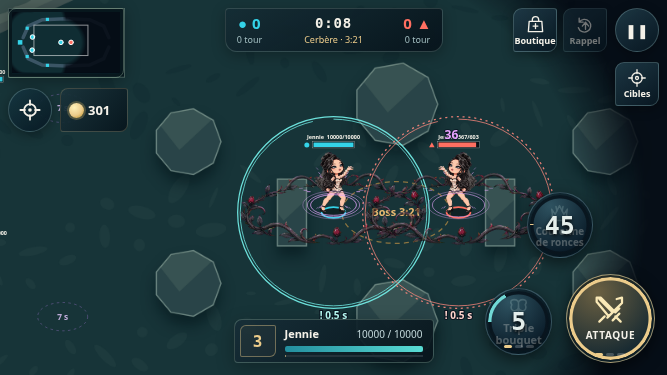

# Lot 3 — complément de feedback de combat

Base synchronisée : `10b70e8`, branche `feat/hybrid-camera-polish`, avec les lots 2, 3 initial et HUD déjà intégrés. Ce complément conserve les retours existants et comble les manques observés dans le dépôt. Aucun déploiement.

## Fichiers et comportement

- `src/render/combat-fx.js` : halo et traînée directionnelle des projectiles, anneau distinct à leur contact réel, écho discret de la même cellule de sprite pendant les segments mobiles des dashs. Les traînées de mêlée restent synchronisées sur `hitMs`. Flash réduit à 80 ms et opacité additive maximale de 0,4 pour laisser le personnage visible.
- `src/render/renderer.js` : raccord des ajouts autour des textures existantes. Contours des zones derrière les unités, au rayon exact de la simulation. Turquoise continu pour les alliés, rouge interrompu pour les ennemis ; compte à rebours précédé de « ! » pendant l'armement des ronces et arc de durée en mode complet. Les textures, animations et boucliers existants sont conservés.
- `src/ui/sound.js` : lancement de compétence court, sons d'impact existants conservés, gain général de 0,65 et compresseur WebAudio unique. Le limiteur d'événements de combat reste à 75 ms. Le son coupé ne crée aucune nouvelle voix.
- `tests/combat-fx.test.js`, `tests/sound.test.js` : tests des nouveaux indicateurs, timing des dashs, collisions, visibilité, budget et routage audio.
- `tools/*combat*.cjs`, `docs/benchmarks/` : scénarios reproductibles, mesures brutes avant/après et capture mobile.

Les ultimes gardent leurs deux temps visuels, lancement puis activation. Les éliminations gardent leur bandeau court et leur son identifiable. Les éclats passent de 5 à 3 pour un impact ordinaire et de 8 à 6 pour un effet majeur ; 32 impacts simultanés maximum en mode complet, 8 en mode allégé. Les petites compétences ne provoquent plus automatiquement une secousse : seuls ultimes, gros impacts (au moins 25 % des PV maximum) et éliminations locales peuvent la déclencher, avec les plafonds et exclusions de visée existants.

Le mode allégé et le mouvement réduit du système suppriment échos, traînées décoratives, flash, particules, arc animé et secousses. Halo, contours de danger, compte à rebours et chiffres restent lisibles. La pause fige les durées. Aucun changement dans `src/sim/`, les données, l'équilibrage, les commandes, les hitbox, le ciblage ou les règles de vision. Aucun module de jeu ajouté, donc aucune synchronisation supplémentaire de carte d'import nécessaire.

## Validation

- `npm test` : 255 tests réussis.
- Chromium : Yeji, Sweetie et Jennie en 844 × 390, 667 × 375 et 1440 × 900 ; 9 scénarios attaques/ultimes/élimination/préférences et 9 scénarios compétences/zones/son coupé. Aucune erreur JavaScript observée.
- Vérification des sons distincts au véritable impact, du silence après désactivation et de la persistance du mode allégé ; priorité du mouvement réduit système.
- Comparaison de la visibilité de rendu avec la simulation pour les deux camps et les neutres, sources mortes, invisibilité et limites exactes de portée. Les sources sont réutilisées pendant une image, sans mémoriser leurs coordonnées interpolées ni modifier la vision.
- L'état des unités est identique avant/après les dessins interpolés et la scène de stress.

## Performances avant/après

Chromium headless du même environnement, viewport 844 × 390, DPR 2, graine 77. Six héros immobiles, quatre zones actives et un projectile ; 3 impacts de présentation (« normal ») ou 80 événements consécutifs (« dense »). Trois séries de 25 dessins de chauffe puis 100 dessins chronométrés, sans tests en parallèle. Le tableau prend la médiane des trois médianes et des trois p95, en millisecondes. Les JSON conservent chaque série. Le script mesure le temps CPU de `renderer.draw`, pas les FPS physiques ni le temps GPU complet.

| Mode / charge | Médiane avant → après | p95 avant → après | Appels `Array.filter` / dessin avant → après |
| --- | --- | --- | --- |
| Complet / normal | 14,7 → 14,7 | 16,5 → 17,4 | 52 → 5 |
| Complet / dense | 16,9 → 15,6 | 21,4 → 17,5 | 174 → 5 |
| Allégé / normal | 15,6 → 15,6 | 19,1 → 16,9 | 49 → 5 |
| Allégé / dense | 15,3 → 15,5 | 16,9 → 17,2 | 67 → 5 |

Le coût médian reste proche en charge normale, avec amélioration de la scène dense complète. Le comptage de `filter` documente une réduction des tableaux temporaires, sans prétendre mesurer toutes les allocations. Les écarts faibles et les p95 restent sensibles au bruit de cette machine partagée. Une première mesure simultanée aux tests CPU a été écartée et remplacée par cette mesure isolée.

Pour reproduire : lancer `npm start`, puis `node tools/benchmark-combat-feedback.cjs /tmp/feedback.json`, `node tools/validate-combat-effects.cjs` et `node tools/validate-combat-feedback.cjs`. Ces outils facultatifs utilisent Playwright et `/usr/bin/chromium` de l'environnement de validation ; aucune dépendance n'est ajoutée au jeu. Pour la référence, servir le commit `10b70e8` et utiliser la même copie du script. Les scénarios modifient uniquement leur monde de test (positions, PV et progression), jamais les données du jeu.

## Vérifications manuelles restantes

Sur téléphone physique : juger le volume au casque et au haut-parleur, mesurer la stabilité après plusieurs minutes de combat et valider le confort des contours/durées sous les pouces. Aucun téléphone physique disponible ici. L'émulation de viewport ne remplace pas ces essais. Sur mobile et PC, contrôler aussi la lisibilité des dashs en mouvement rapide, les zones superposées, les ultimes au bord du brouillard et le retour d'élimination pendant un objectif majeur.
